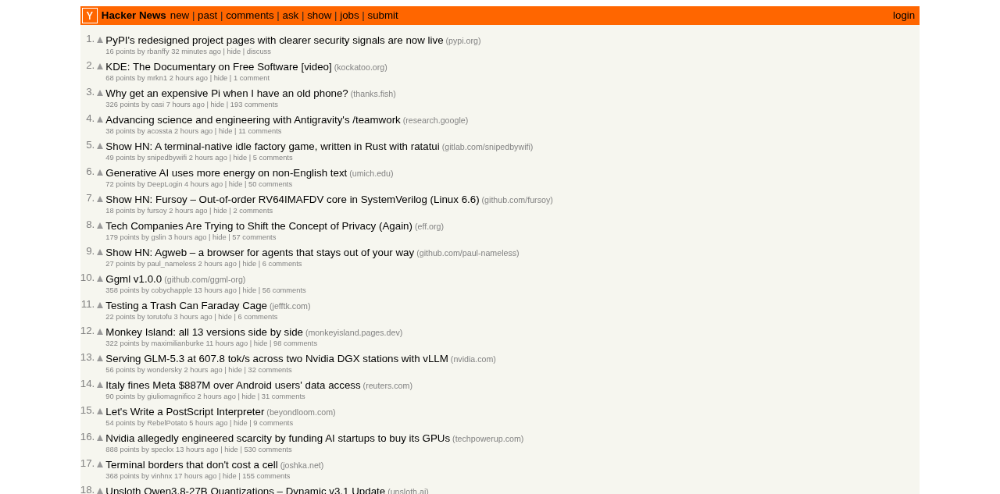

# Omarchy sandbox template

**Omarchy as an agent OS** in a Docker container or a Docker Sandboxes
(`sbx`) microVM: Omarchy's CLI/TUI environment with Herdr, Tmux, Claude
Code, Codex, OpenCode, Gemini, and Copilot, without the Hyprland desktop.

## Quick start

The image is on Docker Hub as
[`juntaoyuan/omarchy-sandbox`](https://hub.docker.com/r/juntaoyuan/omarchy-sandbox).

### 1. Start the container or sandbox

**Docker container:**

```bash
docker run -dit --name omarchy \
  -v "$PWD":/home/agent/workspace \
  juntaoyuan/omarchy-sandbox:4.5.0
```

**sbx sandbox (microVM):**

```bash
sbx login                     # once: sign in with your Docker account
sbx policy init balanced      # once: or allow-all / deny-all

cd ~/my-project
sbx create -t juntaoyuan/omarchy-sandbox:4.5.0 --name omarchy shell .
```

On Linux, the user running `sbx` needs access to `/dev/kvm` (usually the `kvm` group).

**Docker cloud sandbox** (runs on Docker's cloud, after the same
`sbx login`):

```bash
sbx --cloud run --detach \
  --image-ref docker.io/juntaoyuan/omarchy-sandbox:4.5.0 \
  --cpus 2 --memory 4g --ttl 2h \
  --name omarchy
```

`--cpus 2 --memory 4g` is the "small" size; cloud sandboxes are billed by
size and time, and `--ttl 2h` times this one out after two hours. No host folder
is mounted, so clone your repos inside the sandbox.

### 2. Log in to the container or sandbox

```bash
docker exec -it omarchy bash -l          # Docker
sbx exec -it omarchy bash -l             # sbx
sbx --cloud exec -it omarchy bash -l     # Docker cloud sandbox
```

You get a bash login shell as user `agent` in `/home/agent/workspace`
(your project directory, or an empty folder in a cloud sandbox). Herdr's
server is already running.

### 3. Start Herdr

```bash
herdr
```

On first launch Herdr shows a welcome screen; press Enter, then Esc.

### 4. Start Claude Code in Herdr

In the first pane:

```bash
claude
```

### 5. Start Codex in another Herdr pane

Press **Ctrl+Space**, then **v** to split the window and open a new pane
on the right (Ctrl+Space, then **h** opens one below). In the new pane:

```bash
codex
```

Claude Code and Codex ask you to sign in or enter an API key the first
time they run.

From a script or another shell in the container, the same split works
through the CLI:

```bash
herdr pane list                                  # find a pane id, e.g. w1:p1
herdr pane split w1:p1 --direction right         # prints the new pane id, e.g. w1:p2
herdr pane run w1:p2 codex
```

### Useful Herdr keys

Omarchy's Herdr config uses **Ctrl+Space** as the prefix:

| Keys | Action |
| --- | --- |
| Ctrl+Space, v | Split; new pane on the right |
| Ctrl+Space, h | Split; new pane below |
| Ctrl+Alt+arrow | Move focus between panes |
| Ctrl+Space, x | Close pane |
| Ctrl+Space, z | Zoom pane |
| Ctrl+Space, c | New tab |
| Ctrl+Space, d | Detach (Herdr and your panes keep running) |
| Ctrl+Space, ? | Help |

Run `herdr` again to re-attach.

### Stop and clean up

```bash
docker rm -f omarchy                # Docker
sbx stop omarchy; sbx rm omarchy    # sbx
sbx --cloud rm -f omarchy           # Docker cloud sandbox
sbx --cloud ls                      # check nothing is left running
```

## How Herdr runs here

**Herdr lives inside the container or sandbox, not on the host.** The server
listens on a Unix socket inside it, `/home/agent/.config/herdr/herdr.sock`.
Every `herdr` command, including the TUI, must run inside, so get a shell
there first. A `herdr` binary on the host cannot see that socket, and Herdr
does not listen on the network.

The server is started by `/etc/sandbox-env.sh`, which bash reads through
`BASH_ENV` or the login and interactive startup files. The first **bash**
process inside starts it, including the interactive bash that
`docker run -dit` uses as the main process. A command that is not run
through bash, such as `docker exec omarchy herdr status server`, does not
start it and reports `status: not running` until some bash has run.

```bash
herdr status server     # status: running, socket: /home/agent/.config/herdr/herdr.sock
herdr session list      # default  running  ...
herdr agent list
herdr --skill           # agent skill file
docker exec omarchy bash -c 'herdr status server --json'    # from the host
sbx exec omarchy bash -c 'herdr status server --json'       # from the host
```

Set `OMARCHY_SANDBOX_SKIP_HERDR=1` if you do not want the server auto-started.
The Herdr desktop app (`herdr-app`) and Hyprland theme sync are not
installed. Super keybindings (`Super + Ctrl + Return`, and so on) are not
available.

Tmux is also installed with Omarchy's config (`tmux new-session -s work`).
Herdr and Omarchy's Tmux config both use **Ctrl+Space** as the prefix. Run
one or the other in a terminal, not Herdr inside Tmux (or the reverse),
unless you change one prefix.

## Browse the web

Google Chrome is installed as `google-chrome-stable`. In this container a
PATH wrapper adds `--no-sandbox` and `--disable-dev-shm-usage`, so the
usual headless CLI flags work as the `agent` user:

```bash
google-chrome-stable --headless --dump-dom https://example.com
google-chrome-stable --headless --screenshot=page.png https://example.com
google-chrome-stable --headless --print-to-pdf=page.pdf https://example.com
```

Agents can drive the same Chrome with two CLIs, also on PATH:

```bash
# Vercel agent-browser (uses AGENT_BROWSER_EXECUTABLE_PATH)
agent-browser open https://example.com
agent-browser snapshot -i

# Google Chrome DevTools CLI (headless by default)
chrome-devtools new_page "https://example.com"
chrome-devtools take_screenshot 1 --filePath page.png
chrome-devtools stop
```

`chrome-devtools-mcp` is pre-registered for Claude Code, Codex, and
Gemini, and pointed at this Chrome (`--headless`, `--isolated`). The
Chrome DevTools skills are copied into each agent's skills directory.
Do not run `agent-browser install`; that would download a second Chrome.



Claude Code in the sandbox browsing Hacker News with Chrome.

The kit:

```text
omarchy-sandbox/
├── Dockerfile                     # image build from archlinux:base-devel
├── omarchy-sandbox.yaml           # v3 workload kit descriptor
├── context.md                     # agent instructions (written as AGENTS.md)
├── scripts/                       # Herdr install, repo setup, and auto-start
└── README.md
```

## Get or build the image

### Option A — pull from Docker Hub (recommended)

```bash
docker pull juntaoyuan/omarchy-sandbox:4.5.0
```

Tags `4.5.0` and `latest` (linux/amd64, about 1.78 GB compressed). `sbx run`
and `sbx create` with `-t juntaoyuan/omarchy-sandbox:4.5.0` pull it on
their own.

### Option B — move a saved image (tarball, offline)

On a machine that has the image:

```bash
docker image save omarchy-sandbox:4.5.0 -o omarchy-sandbox.tar
```

Copy the tarball over, then load it where you need it:

```bash
docker image load -i omarchy-sandbox.tar     # plain Docker
sbx template load omarchy-sandbox.tar        # Docker Sandboxes
sbx create --pull never -t omarchy-sandbox:4.5.0 --name omarchy shell .
```

The tarball is only for machines that cannot pull from Docker Hub; plain
Docker never needs it when you can pull or build. `sbx` keeps its own image
store, separate from Docker's, so it needs `sbx template load` plus
`--pull never`.

**Do not commit the tarball to git.** It is about 4.2 GB, GitHub rejects any
file over 100 MB, and `*.tar` is in `.gitignore`. Share new versions by
pushing to Docker Hub:

```bash
docker tag omarchy-sandbox:4.5.0 juntaoyuan/omarchy-sandbox:4.5.0
docker tag omarchy-sandbox:4.5.0 juntaoyuan/omarchy-sandbox:latest
docker push juntaoyuan/omarchy-sandbox:4.5.0
docker push juntaoyuan/omarchy-sandbox:latest
```

### Option C — rebuild from this kit

```bash
docker build --build-arg OMARCHY_VERSION=v4.5.0 -t omarchy-sandbox:4.5.0 .
```

This starts from `archlinux:base-devel` and installs everything with
pacman, npm, yay, and LazyVim. Each build step deletes its own downloads
and caches before it ends (see `NOTES.md`). A local build is tagged `omarchy-sandbox:4.5.0`; use that name in
place of `juntaoyuan/omarchy-sandbox:4.5.0` in the commands above.

## Agent credentials

### sbx: keep keys on the host

Store OpenAI credentials **on the host**, never in the image:

```bash
sbx secret set openai           # API key (prompted)
sbx secret set openai --oauth   # or ChatGPT login; the browser runs on the host
```

Then run Codex as the sandbox agent, from a project directory:

```bash
sbx run codex --template juntaoyuan/omarchy-sandbox:4.5.0
```

The built-in `codex` agent keeps its own launch command and credential
proxy; this template only replaces the OS and tool image. OAuth or browser
login **inside** a plain `shell` sandbox usually fails, and proxy-managed
credentials may not be injected there unless you launch the v3 kit below.

### v3 kit path

From this directory:

```bash
sbx secret set openai    # once, on the host
sbx run --name omarchy-sandbox ./omarchy-sandbox
```

The default launch is bash (`CMD ["/bin/bash"]`; no agent `ENTRYPOINT`).
Run `codex` inside. The kit declares a proxy-managed `openai` credential:
approve the binding when prompted so requests to `api.openai.com` (and the
other listed OpenAI hosts) get `Authorization: Bearer …` injected on the
host. The real key stays on the host. Hosts not in the kit's allow-list are
blocked on this path; add more to `omarchy-sandbox.yaml` if pacman, yay, or
git need them.

### Plain Docker

```bash
docker run -it --rm \
  -e OPENAI_API_KEY \
  -v "$PWD":/home/agent/workspace \
  juntaoyuan/omarchy-sandbox:4.5.0
# then:
codex
```

This puts the API key **inside the container**, unlike `sbx run codex`.

## Persistent environment

Use `/etc/sandbox-persistent.sh` for exports that later Bash sessions need.
Login, interactive, and non-interactive shells source it through
`/etc/sandbox-env.sh` (`BASH_ENV` is set). That wrapper also starts the
Herdr server. Do not put shell completion in either file.

## What is in the image

| Item | Value |
| --- | --- |
| User | `agent`, UID/GID 1000, home `/home/agent` |
| Workdir | `/home/agent/workspace` |
| Omarchy | v4.5.0 (commit `ac2690c`, recorded in `/etc/omarchy-sandbox-release`); `omarchy-version` prints `dev` |
| `omarchy` | on PATH for login, non-interactive, and interactive bash |
| herdr | 0.9.5, official Omarchy package; headless `herdr server` auto-starts |
| Google Chrome | `google-chrome-stable`, headless-ready in this container |
| Chrome DevTools | `chrome-devtools` CLI and `chrome-devtools-mcp` (Google) |
| agent-browser | Vercel CLI, pointed at the image's Chrome |
| Claude Code | `claude` 2.1.325 |
| Codex CLI | `codex-cli 0.169.0` |
| tmux | 3.8, with Omarchy's `tmux.conf` (`Ctrl + Space` prefix) |
| nvim | v0.12.6 (LazyVim) |
| lazygit | 0.66.3 |
| starship | 1.27.0 |
| git | 2.56.1 |

Also installed: `opencode`, `gemini`, `copilot`, base-devel (gcc, make),
mise, yay, fastfetch, ripgrep, fd, fzf, bat, eza, zoxide, jq, and tldr.

Left out on purpose, because a headless agent OS does not use them:

- Omarchy's theme wallpapers, intro videos, and preview images (only the
  Hyprland desktop shows them; the text theme files stay) and the Omarchy
  clone's `.git` (another full copy of those files).
- Man pages. The Arch base image never extracts them, so `man-db` is not
  installed; use `tldr <cmd>` or `<cmd> --help`.
- Package and build caches (pacman, npm, yay/makepkg, nvim) and `-debug`
  packages; makepkg's `debug` option is off.
- opencode's second, unused platform binary.

## Limitations

This is **not** official Omarchy, and it is **not** a full Omarchy install.

- **CLI/TUI only.** Hyprland, a GPU, systemd, Limine, Btrfs, SDDM, and uwsm
  are not in this image. Many `omarchy-*` desktop and hardware commands will
  fail.
- **Docker's kernel, not Omarchy's.** Docker Sandboxes still boots Docker's
  microVM kernel. This template only changes the userland (packages, configs,
  and CLIs).
- **linux/amd64 and large.** The image is about **4.16 GB** unpacked.
- **Network allow-list (v3 kit only).** `omarchy-sandbox.yaml` allows a fixed
  set of hosts (OpenAI, GitHub, npm, PyPI, Arch/AUR mirrors). Other hosts are
  blocked when you launch the kit with `sbx run ./omarchy-sandbox`. The
  `--template` path with built-in agents (`sbx run codex` or `sbx run shell`)
  uses those agents' own network and credential policies instead.
- **LazyVim** was installed with a best-effort headless sync. It may need a
  first-run update inside the sandbox.
- **No Docker Engine inside the image.** There is no nested Docker daemon.
