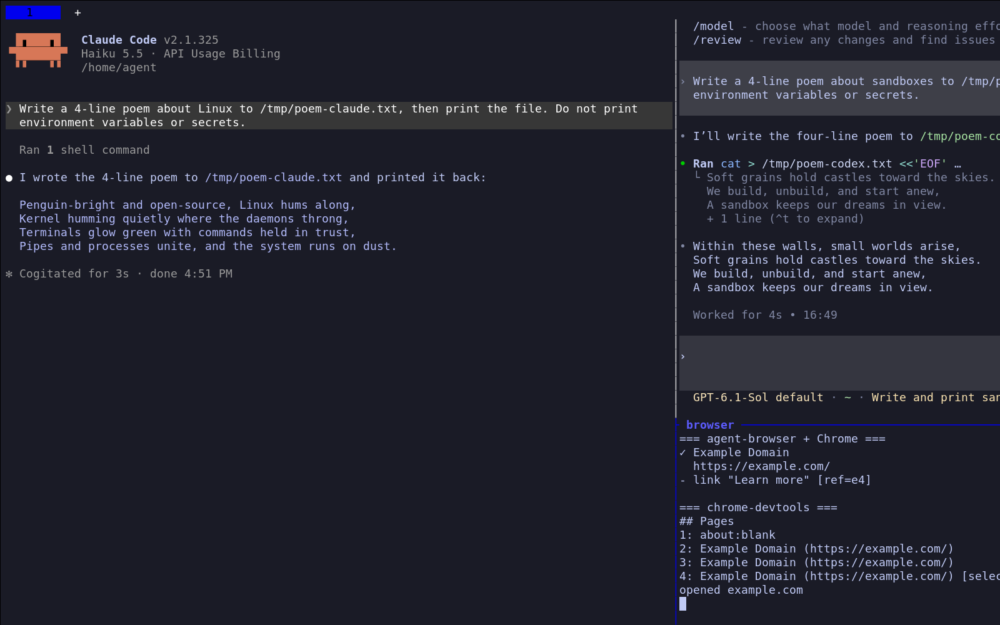
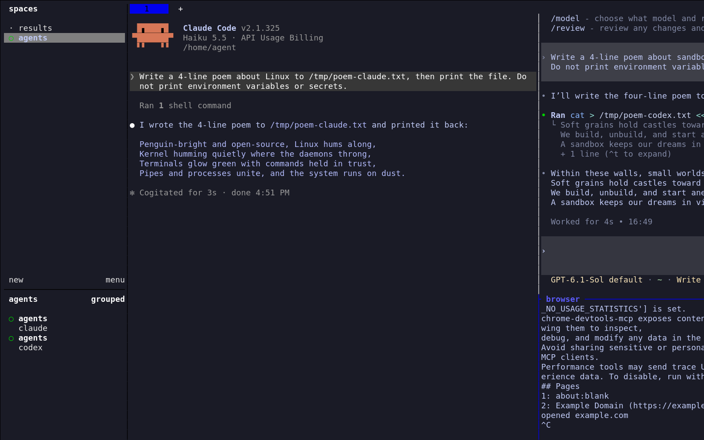

# Omarchy as an Agent OS in Docker Sandboxes

[Omarchy Linux](https://omarchy.org/) is a next-generation, opinionated Linux desktop and an *agent OS*. For a person at a keyboard, it is a complete Arch-based environment with a chosen set of tools, themes, and defaults. For an AI coding agent, it is a userland the agent inspects and changes through command-line tools and plain-text config.

Those two roles share a lot of machinery, but they do not have to share a display. The [omarchy-sandbox](https://github.com/juntao/omarchy-sandbox) image takes Omarchy's CLI and TUI stack, leaves the Hyprland desktop out, and runs that agent OS in [Docker Sandboxes](https://docs.docker.com/ai/sandboxes/) (`sbx`). The image provides a shell, a multiplexer, browsers the agent can drive, and the coding agents themselves, isolated from your laptop.

## An OS that agents can actually operate

A desktop is friendly to humans when its settings live in menus. An OS is friendly to agents when those same settings are commands and files. Omarchy leans that way. The `omarchy` wrapper and the `omarchy-*` commands on `PATH` are ordinary programs. An agent that can run a shell can list themes, switch fonts, query packages, or change defaults without opening a control panel.

In the published `juntaoyuan/omarchy-sandbox:4.5.0` image, these are real, working examples:

```bash
omarchy theme list              # Catppuccin, Nord, Tokyo Night, and others
omarchy theme dir "Tokyo Night" # path to that theme's text files
omarchy font list
omarchy font current            # DejaVu Sans Mono in this image
omarchy pkg present git tmux nvim
omarchy pkg missing firefox
omarchy default agent
omarchy default browser
omarchy default editor
omarchy default terminal
omarchy mise install
```

The matching configuration is plain text under the agent's home directory: `~/.config/omarchy/`, `~/.config/herdr/config.toml`, `~/.config/starship.toml`, and the usual git, tmux, and editor files. An agent can read them, patch them, and verify the result with another CLI call.

Not every Omarchy command belongs in a headless sandbox. The image still ships many `omarchy-hyprland-*` helpers and hardware tools (brightness, battery, and the like). Those targets need the desktop or the physical machine, and they fail here, as the image's limitations describe. Agents should use the CLI and TUI layer: packages, themes as text, fonts, mise, and the default-app helpers.

Browser use is part of that layer. The image includes Google Chrome (`google-chrome-stable`), Google's [chrome-devtools-mcp](https://github.com/ChromeDevTools/chrome-devtools-mcp) with its `chrome-devtools` CLI, and Vercel's [agent-browser](https://github.com/vercel-labs/agent-browser), already pointed at that Chrome. Agents can open a page, take a snapshot, or drive DevTools without installing a second browser:

```bash
agent-browser open https://example.com
agent-browser snapshot -i

chrome-devtools new_page "https://example.com"
chrome-devtools take_screenshot 1 --filePath page.png
chrome-devtools stop
```

`chrome-devtools-mcp` is pre-registered for Claude Code, Codex, and Gemini, so those agents can use the same Chrome through MCP as well as from the shell.

The image also comes with the agents and coordination tools already installed: Claude Code, Codex, OpenCode, Gemini, and Copilot, plus Herdr, Tmux, Neovim (LazyVim), lazygit, and mise. Herdr is Omarchy's terminal workspace manager for coding agents. You can run Claude in one pane, Codex in another, and a browser CLI in a third, then detach and come back later. Tmux is there too, with the same Ctrl+Space prefix Omarchy uses on the desktop. Those tools ship in the image, so an agent does not have to install them first.

## Agents need a sandbox, and the agent OS does too

Coding agents are not deterministic, and they are most useful when they have a real computer: a shell, a filesystem, a package manager, a browser, network access, and the ability to start other tools. That combination is risky on a shared workstation. The agent OS should run in a sandbox: a full machine from the inside, and a disposable, policy-bounded environment from the outside.

[Docker Sandboxes](https://docs.docker.com/ai/sandboxes/) is built for that job. Official documentation describes a sandbox as a [microVM](https://docs.docker.com/ai/sandboxes/architecture/): the agent gets its own kernel and its own virtual machine. A Linux container shares the host kernel. Docker's [security overview](https://docs.docker.com/ai/sandboxes/security/) compares this to ordinary containers and to Docker-in-Docker. That isolation is why `sbx` is a better home for an agent OS than a plain container.

**It uses a normal Docker image.** You build or pull an image and use it as a sandbox template. The Omarchy agent OS is on Docker Hub as [`juntaoyuan/omarchy-sandbox`](https://hub.docker.com/r/juntaoyuan/omarchy-sandbox). `sbx create` and `sbx run` can take that tag directly. There is no separate appliance format to learn.

**Network and access control are explicit.** Sandboxes start from a [deny-by-default network policy](https://docs.docker.com/ai/sandboxes/security/). You choose a preset (`balanced`, `allow-all`, or `deny-all`) or write a tighter policy for what the sandbox may reach or mount. Organizations can go further with [governance policies](https://docs.docker.com/ai/sandboxes/security/governance/) that apply the same rules across a team. That is a better default for a non-deterministic agent than an open container on the host network.

**Credentials stay outside the VM.** This differs from a container you start with `-e` or a mounted secrets file. Docker Sandboxes [injects credentials through a host-side proxy](https://docs.docker.com/ai/sandboxes/configuration/credentials/). The official architecture notes that a credential sentinel is rewritten on the host; the real secret is not placed in the virtual machine. You store keys once with `sbx secret set` (including OAuth flows that run on the host) and then start an agent. The Omarchy image itself does not bake credentials in, and it should not.

**The CLI is simple enough for a coordinator to drive.** `sbx login`, `sbx create`, `sbx run`, `sbx exec`, `sbx stop`, and `sbx rm` are ordinary commands. A planning agent on the host can start a sandbox, exec a task, and tear it down. You do not need a custom orchestrator to get a second Omarchy environment.

**The same CLI works locally and in the cloud.** [Local sandboxes](https://docs.docker.com/ai/sandboxes/get-started/) run on your machine (on Linux this needs KVM access, usually membership in the `kvm` group). [Cloud sandboxes](https://docs.docker.com/ai/sandboxes/cloud/) run on Docker's cloud after the same `sbx login`, with pay-as-you-go billing. That lets you keep a short-lived agent OS close to a laptop, or burst the same image into the cloud without rebuilding it.

**Agents can use the host GPU for local inference.** A local sandbox reaches models on your machine by pairing Docker Sandboxes with [Docker Model Runner](https://docs.docker.com/ai/model-runner/). Allow the sandbox to reach the runner with `sbx policy allow network localhost:12434`. Inside the sandbox, the agent calls `http://host.docker.internal:12434`. Docker Model Runner serves an OpenAI-compatible API at `/engines/v1` and an Anthropic-compatible API, so Claude Code can set `ANTHROPIC_BASE_URL` to that host endpoint. This works with local sandboxes only. A cloud sandbox cannot reach a model runner on your machine. Docker documents GPU support for Apple Silicon (Metal), NVIDIA GPUs with CUDA, and on Linux, AMD GPUs with ROCm or Vulkan. [Docker's guide to Claude Code with Model Runner in a sandbox](https://docs.docker.com/guides/claude-code-sandbox-model-runner/) walks through the policy and the `ANTHROPIC_BASE_URL` setup. The [sandbox model configuration](https://docs.docker.com/ai/sandboxes/configuration/models/) page covers other local and hosted model options.

[Open LLMs on Your Own Computer](https://www.manning.com/liveprojectseries/open-llms-on-your-own-computer), my liveProject series with Tony Yuan at Manning, covers running Gemma 4 with Docker Model Runner, serving an OpenAI-compatible API to Open WebUI and the pi agent, and using local models for vision, OCR, and hybrid local-and-cloud inference.

Official docs also describe:

- [Workspace mounts and file sync.](https://docs.docker.com/ai/sandboxes/usage/) `sbx run` mounts the current directory into the sandbox (via virtiofs on the local path). `sbx create` can start a sandbox with or without a mount. Cloud sandboxes do not mount a host folder, so you clone work inside them.
- [Templates.](https://docs.docker.com/ai/sandboxes/usage/) Official agent templates exist for the built-in coding agents. You can also point `sbx` at your own image, which is how the Omarchy agent OS is used here.
- [TTL and size.](https://docs.docker.com/ai/sandboxes/cloud/) Cloud sandboxes accept `--ttl` (and a timeout action) and `--cpus` / `--memory`, so a coordinator can cap cost and lifetime. The default cloud TTL is one hour if you do not set one.
- [Docker-in-sandbox, with a caveat.](https://docs.docker.com/ai/sandboxes/architecture/) Official `sbx` agent templates include a private Docker engine inside the sandbox. The Omarchy image does not: it has no Docker Engine in the userland, which is called out in the project's limitations. Do not assume `docker` will work inside this particular template.

## Quick start: Omarchy in a sandbox, then several agents in Herdr

The image is `juntaoyuan/omarchy-sandbox:4.5.0`. It has no desktop session; you get a shell as user `agent` in `/home/agent/workspace`.

Local Docker Sandboxes:

```bash
sbx login                     # once: sign in with your Docker account
sbx policy init balanced      # once: or allow-all / deny-all

cd ~/my-project
sbx create -t juntaoyuan/omarchy-sandbox:4.5.0 --name omarchy shell .
```

Cloud Docker Sandboxes, after the same `sbx login`:

```bash
sbx --cloud run --detach \
  --image-ref docker.io/juntaoyuan/omarchy-sandbox:4.5.0 \
  --cpus 2 --memory 4g --ttl 2h \
  --name omarchy
```

`--cpus 2 --memory 4g` is a small cloud size; `--ttl 2h` stops the sandbox after two hours. Nothing from the host is mounted, so clone repositories inside it. Cloud sandboxes are billed by size and time, so delete them when you are done (`sbx --cloud rm -f omarchy`, then `sbx --cloud ls`).

Log in:

```bash
sbx exec -it omarchy bash -l             # local sbx
sbx --cloud exec -it omarchy bash -l     # cloud sbx
```

Herdr's server is already running inside the environment. Start the TUI with `herdr`. On first launch, press Enter, then Esc, to dismiss the welcome screen.

The terminal workflow is the same as on an Omarchy desktop. In the first pane, start Claude Code:

```bash
claude
```

Press **Ctrl+Space**, then **v**, to split a pane on the right (Ctrl+Space, then **h** splits below). In the new pane:

```bash
codex
```

Split once more and run a browser CLI, for example `agent-browser` or `chrome-devtools`. The prefix is Ctrl+Space throughout: **x** closes a pane, **z** zooms one, **c** opens a new tab, **d** detaches. Detaching leaves Herdr and every pane running. Run `herdr` again from a later shell to reattach to the same workspace.

The same layout can be driven from a script or a coordinator, without the TUI:

```bash
herdr pane list
herdr pane split w1:p1 --direction right
herdr pane run w1:p2 codex
```

The screenshots below show Claude Code in the left pane, Codex in the upper right, and a Chrome-driven CLI in the lower right.



*Claude Code (Haiku) and Codex each wrote a short poem in their own Herdr pane, while the third pane used `agent-browser` and `chrome-devtools` to open example.com.*



*Herdr's sidebar lists workspaces and the agents running in them. The same session can hold a "results" workspace and an "agents" workspace; Ctrl+Space, then d, detaches without stopping either.*


*Zooming a pane (Ctrl+Space, then z) is useful when you want to read browser output in full. Here `agent-browser` has opened Example Domain, and `chrome-devtools` lists the pages in Chrome.*

When you are finished:

```bash
sbx stop omarchy; sbx rm omarchy    # local sbx
sbx --cloud rm -f omarchy           # cloud sbx
sbx --cloud ls
```

## Building the image

The image is a standalone build from `archlinux:base-devel`, not a fork of a desktop ISO. From a clone of [juntao/omarchy-sandbox](https://github.com/juntao/omarchy-sandbox):

```bash
docker build --build-arg OMARCHY_VERSION=v4.5.0 -t omarchy-sandbox:4.5.0 .
```

That Dockerfile is what turns Omarchy into a headless agent OS. It installs the Omarchy CLI and TUI configs (and records the tag and commit in `/etc/omarchy-sandbox-release`), then the agent and multiplexer stack, then Google Chrome, the `chrome-devtools` CLI, `chrome-devtools-mcp`, and `agent-browser`. Chrome and those CLIs let an agent install a package, edit a file, and open a web page.

A short source-level cleanup policy keeps the layers small. Each `RUN` that downloads or builds something deletes its own caches (pacman, npm, yay and makepkg, nvim, `/tmp`) before the step ends, so those files never land in the committed layer. Desktop-only media (theme wallpapers, intro videos, preview images) and the Omarchy clone's `.git` directory are dropped for the same reason: a headless agent OS does not display them.

Publish a new build as a normal Docker Hub image:

```bash
docker tag omarchy-sandbox:4.5.0 juntaoyuan/omarchy-sandbox:4.5.0
docker tag omarchy-sandbox:4.5.0 juntaoyuan/omarchy-sandbox:latest
docker push juntaoyuan/omarchy-sandbox:4.5.0
docker push juntaoyuan/omarchy-sandbox:latest
```

Tags `4.5.0` and `latest` are linux/amd64. After a push, both `docker pull` and `sbx create -t juntaoyuan/omarchy-sandbox:4.5.0` pick up the new userland.

## Contribute

The project lives at [https://github.com/juntao/omarchy-sandbox](https://github.com/juntao/omarchy-sandbox). If you want a package, an agent, or a CLI in the sandbox, or you want a bug in the image or the docs fixed, change it there.

A typical contribution is a Dockerfile or script change, a rebuild, and a check that the new tool works under `sbx` (local or cloud). Keep credentials out of the image and out of git. The repository README is the canonical quick start; this article follows the same commands.
